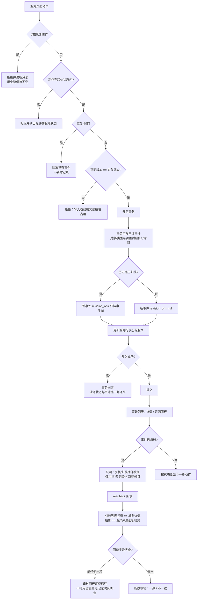

# 变更审计事件链路：从业务动作到归档回读

本文记录 AUDI-0001/0002/0003 与 LIFE-0002、CATA-0002 的调用链梳理结果：原实现的数据断点、
修复后的写入链路、事件流程图与分步说明。

## 一、原调用链断点

原实现里“审计动作”和“业务动作”是两条互不相干的写路径：

```text
审计动作：POST /api/audit/{id}/actions
        -> routers/audit.py: run_action()
        -> services/audit.py: run_action()
        -> 直接写 entry["status"]
        （无状态校验、无前后值、无操作人/时间、无只读）

业务动作：POST /api/lifecycle|/api/catalog/{id}/actions
        -> routers/{module}.py: run_action()
        -> services/{module}.py: run_action()
        -> 直接写 entry["status"]
        （完全不调用审计服务，不产生事件）
```

由此产生的具体断点：

| 现象 | 断点位置 | 根因 |
| --- | --- | --- |
| AUDI-0001 未复核可直接归档、AUDI-0003 归档后还能再复核 | `services/audit.py` `ACTION_RULES` | 规则只写了“目标状态”，没有校验“起始状态”；已归档没有任何只读判断 |
| 生命周期/资产提交的变更只留状态，没有前后值 | `services/lifecycle.py`、`services/catalog.py` | 业务动作从不调用审计写入，前后值、操作人、操作时间无处落 |
| 复核入口没反应、动作不生效 | `routers/*.py` + 前端 | 前端提交 `{action}` 平铺字段，后端只读 `payload.values["action"]`，动作名永远为空 |
| 同一事件重复显示、旧值残留 | 前端列表 + `list_entries` | 行没有稳定唯一键去重，已归档事件仍跟着状态列一起渲染 |
| 业务写成功但审计没写 | 两个 service 各自改内存 | 没有事务，审计失败时业务状态已经改了，接口依然返回成功 |
| 归档列表丢失前后值 | 无事件快照 | 审计事件没有自己的前后值字段，只能靠业务现值推断 |

## 二、修复后的写入链路

```text
业务页面（lifecycle / catalog）
  └─ POST /api/{module}/{id}/actions  {action, expected_version}
       └─ routers/{module}.py: run_action()
            └─ services/{module}.py: run_action()
                 ├─ 校验起始状态 / 已归档只读 / 重复动作
                 ├─ 计算跨模块对象版本（同一表名在 lifecycle 与 catalog 的 max(版本)）
                 ├─ store.transaction():
                 │    ├─ store.assert_all_writable(module, "audit")
                 │    ├─ services/audit.py: record_business_change()
                 │    │    ├─ 必填校验：变更对象/类型/前后值/操作人/操作时间
                 │    │    ├─ 写入权校验：base_version 必须等于对象当前版本
                 │    │    ├─ 重复动作去重：同来源+同类型+同结果版本直接回放
                 │    │    ├─ 历史链已归档时只生成 revision_of 修订事件
                 │    │    └─ store.append("audit", 事件)
                 │    └─ 更新业务行（status/版本/策略状态/最后操作）
                 └─ 失败（AuditError / StoreWriteError）→ 事务回滚 → 返回 ok=false
```

审计账本自己的动作走另一条只读约束更严的路径：

```text
POST /api/audit/{id}/actions {action, operator, remark}
  └─ services/audit.py: run_action()
       ├─ 已归档 + 非恢复操作 → 拒绝，历史链不变
       ├─ 标记复核：要求复核意见；已复核时保留首次复核人与复核时间
       ├─ 归档记录：必须处于已复核；readback_checks 全绿才允许写归档指纹
       └─ 恢复操作：不修改原事件，新建 revision_of 指向原事件的修订事件
```

## 三、事件流程图



## 四、分步说明（事件生命周期）

1. **业务动作入口**
   生命周期/资产页面提交 `action` 与 `expected_version`。路由层只做参数解析，
   状态判断全部落在 `app/services/*`，符合项目“状态流转只在 service 改”的约定。

2. **前置校验**
   `run_action` 依次判断：记录是否存在 → 动作是否属于该模块 → 是否已归档只读 →
   起始状态是否匹配 → 是否属于重复动作 → 页面版本是否等于对象版本（跨模块写入权）。

3. **对象版本计算**
   同一张表在生命周期与资产两个模块里各有自己的行。对象版本取两边 `版本` 的最大值，
   写入成功后业务行抬到 `对象版本 + 1`。因此两个页面基于同一版本并发提交时，
   只有先到的一个能通过，后一个会收到“版本已过期，请刷新后重试”。

4. **审计事件写入**
   `record_business_change` 校验六个必填字段，任何一项为空都抛 `AuditError`，
   业务事务随之回滚。事件字段包括：记录编号、事件链、修订序号、变更对象、变更类型、
   变更前值、变更后值、操作人、操作人账号快照、操作时间、原始提交时间、来源模块、
   来源记录编号、变更对象主键、基底版本、结果版本。

5. **重复动作去重**
   同一来源 + 同一变更类型 + 同一结果版本视为重复动作，直接回放已写入的事件，
   不新增记录。审计账本侧的“连续点击两次复核”同理：第二次只提示“保留首次复核结论”。

6. **归档前回读校验**
   归档动作要求 `readback_checks` 全部存在，包括变更对象、变更前值、操作人账号快照、
   复核人、复核时间、复核意见、变更对象主键、来源记录编号、原始提交时间、变更后值。
   缺任何一项都会在审核面板标明，并拒绝归档——而不是用当前账号或当前时间临时补全。

7. **归档与只读**
   归档时写入 `归档指纹`（对不可变事实做稳定序列化后的 SHA-256），状态置为已归档。
   之后任何复核/归档请求都会被拒绝；`恢复操作` 只新建一条 `revision_of` 指向原事件的
   修订引用，原事件的状态、指纹、前后值一字不改。

8. **回读三处一致**
   `GET /api/audit/{id}/readback` 同时取“归档列表投影”“单条详情投影”“资产来源面板投影”，
   三者都来自同一份事件快照，并返回 `一致`、`指纹校验`、`缺失项`。
   业务页面通过 `GET /api/{module}/{id}/events` 渲染来源事件，不读取业务对象当前值。

9. **治理清单**
   `GET /api/lifecycle/governance`、`GET /api/catalog/governance` 直接汇总审计事件，
   按来源模块严格过滤，避免同一事件在两个清单里重复计数。

## 五、对照数据

| 事件 | 变更对象 | 变更类型 | 变更前值 | 变更后值 | 操作人 | 操作时间 | 状态 |
| --- | --- | --- | --- | --- | --- | --- | --- |
| AUDI-0001 | dws_user_profile（LIFE-0002 保留期） | 保留期调整 | 保留期 30 天 | 保留期 90 天 | zhangwei | 2026-09-02T09:30:00 | 已记录 |
| AUDI-0002 | dws_user_profile（CATA-0002 资产等级） | 资产等级调整 | 数据等级 L2 | 数据等级 L3 | liqiang | 2026-09-02T14:05:00 | 已复核 |
| AUDI-0003 | ads_gmv_daily（LIFE-0003 归档） | 归档表 | 已到期 | 已归档 | wangwu | 2026-09-03T10:00:00 | 已归档 |

- LIFE-0002 当前 `保留天数 = 90`、`最后操作 = 保留期 30 天 -> 90 天`，与 AUDI-0001 前后值吻合。
- CATA-0002 当前 `数据等级 = L3`，与 AUDI-0002 的变更后值吻合。
- `GET /api/audit/2/business-check` 会标出主来源记录与上下文引用记录，只有主来源
  （`catalog:CATA-0002`）需要体现本事件的前后值。

## 六、演练落库失败

```bash
# 打开 lifecycle 模块的写入失败开关
curl -X POST 'http://127.0.0.1:8000/api/_simulate/write-failure?module=lifecycle&enabled=true'
# 再执行业务动作：接口返回 ok=false，业务状态保持原值
curl -X POST 'http://127.0.0.1:8000/api/lifecycle/1/actions' \
  -H 'Content-Type: application/json' -d '{"action":"启用策略","expected_version":0}'
# 关闭开关
curl -X POST 'http://127.0.0.1:8000/api/_simulate/write-failure?module=lifecycle&enabled=false'
```
